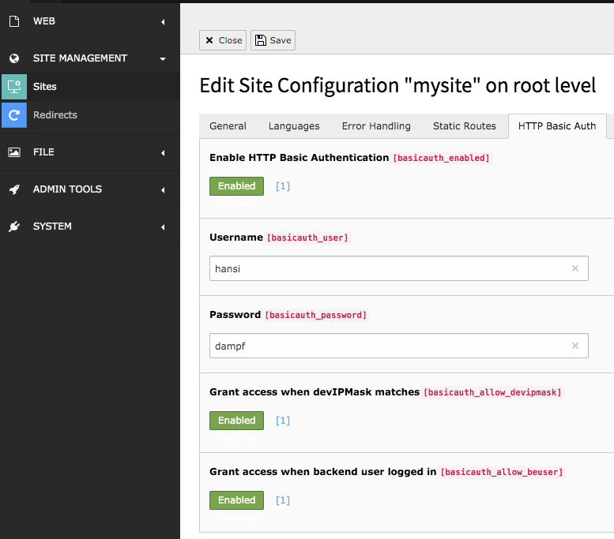

# HTTP Basic Authentication for TYPO3

Protects a site with HTTP Basic Authentication, configured per site in the site configuration.

> **Fork notice:** This is a maintained fork of [christophlehmann/httpbasicauth](https://github.com/christophlehmann/httpbasicauth)
> by Christoph Lehmann, published as `svenjuergens/httpbasicauth`. It adds TYPO3 v14 support.
> For TYPO3 v12, use the original package `christophlehmann/httpbasicauth` (2.x).

## Installation

TYPO3 13.4 LTS and 14.3 LTS are supported. The fork is available via Composer only (not in TER):

```
composer require svenjuergens/httpbasicauth
```

The package replaces `christophlehmann/httpbasicauth` and keeps the extension key `httpbasicauth`
and the PHP namespace. To switch from the original package, remove it first:

```
composer remove christophlehmann/httpbasicauth
composer require svenjuergens/httpbasicauth
```

## Site Configuration

The extension adds the tab "HTTP Basic Auth" to the site configuration:

* Enable HTTP Basic Authentication
* Credentials, one `user:password` combination per line
* Grant access when `devIPmask` matches
* Grant access when a backend user is logged in



## Webserver environment

You may need to add `SetEnvIf Authorization .+ HTTP_AUTHORIZATION=$0` to your `.htaccess` to make it work,
see [christophlehmann/httpbasicauth#6](https://github.com/christophlehmann/httpbasicauth/issues/6).

## Support

For help with this fork, please visit the [issue section](https://github.com/SvenJuergens/httpbasicauth/issues) on GitHub.

The extension was created by Christoph Lehmann.
